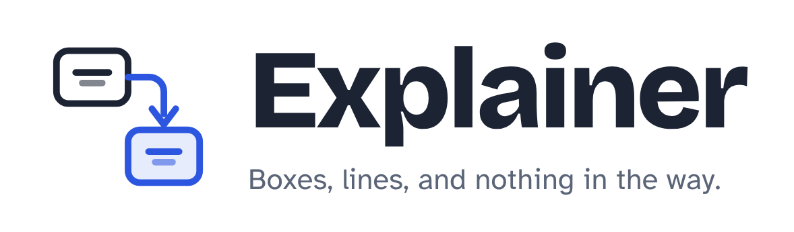
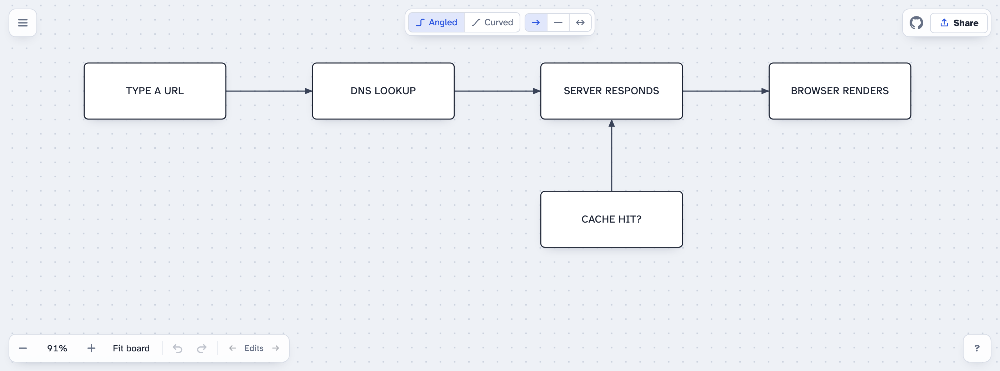

  <picture>
    <source media="(prefers-color-scheme: dark)" srcset="docs/logo-dark.png">
    
  </picture>

  A tiny whiteboard for explaining things. Draw a box, type, connect it to the next one. 
  No sign-up, no install, no menus to learn. One HTML file.

  <a href="https://andidev.github.io/explainer/"><strong>Try it in your browser →</strong></a>

  <picture>
    <source media="(prefers-color-scheme: dark)" srcset="docs/screenshot-dark.png">
    
  </picture>

## What it's for

Explainer is for the moment when you need to show how something works: a process, a system, an
idea, the steps of a decision. Tools like Draw.io can do far more, and that is the problem when all
you need is a few boxes and arrows in the next two minutes. Explainer does only that, and gets out
of the way.

- Sketching how a system fits together during a call
- Walking a teammate or a customer through a flow
- Planning steps before writing them down
- Sending someone a diagram as a link, without an account or a file

## How it works

**Draw.** Drag on empty space, or double-click it, and a box appears with the cursor already in it.
Text stays centred and wraps. When the box fills up it grows by half again, so you never stop to
resize. Text shows in capitals by default; the **All caps** button switches to **Sentence case**
(a capital starts each sentence) or **As typed**, and your text is kept as you typed it.

**Connect.** Move toward the edge of a box and the nearest connection dot appears. Drag it onto
another box. Lines find their own way around other boxes, and you can choose angled or curved lines.
Hold Shift as you drop it for a plain line without an arrow, or Shift+Ctrl for arrows at both ends.
(Double-clicking a dot before dragging also gives a line without an arrow.)

**Arrange.** Drag a box from anywhere to move it, and its lines follow. Drag across several items to
select them, or Shift+click to add to the selection. Boxes snap to the grid unless you turn it off.

**Share.** The whole board lives in the page's address, so the link *is* the diagram. Refresh and it
is still there. Use **Share** to copy a link to the whole board or to only the items you selected.
Your settings, including light or dark mode, travel with the link.

## Shortcuts

| Action | Keys |
|---|---|
| New box | Drag on empty space |
| New box, same size as your last one | Double-click empty space |
| New box, default size | Shift+double-click |
| New box, size of the last selected box | ⌘+Shift+double-click (Ctrl+Shift on Windows) |
| Edit text / select all text | Click the text / double-click the box |
| Select the box | Click around the text |
| Add to selection | Shift+click, or drag across items |
| Delete selected | Backspace or Delete |
| Delete the box you're typing in, when it's empty | Backspace or Delete |
| Plain line / arrows both ways | Hold Shift / Shift+Ctrl while dropping a line |
| Arrow from the selected box to another box | ⌘+click the other box (Ctrl+click on Windows) |
| …a line without arrowheads instead | ⌘+Shift+click (Ctrl+Shift+click on Windows) |
| …arrowheads at both ends instead | ⌘+Shift+Ctrl+click (Ctrl+Shift+Alt+click on Windows) |
| Select everything | Ctrl/⌘ A |
| Copy / cut / paste the selection | Ctrl/⌘ C / X / V |
| Undo / redo | Ctrl/⌘ Z / Shift+Ctrl/⌘ Z |
| Jump between your recent edits | Alt+← / Alt+→ |
| Pan / zoom | Scroll or Space+drag / Ctrl+scroll |
| Snap to grid on or off | G |
| Theme: Auto, Light, Dark | T |
| Stop editing | Esc |

The same list is in the app, behind the **?** button.

## Run it

Use it online at **[andidev.github.io/explainer](https://andidev.github.io/explainer/)**, or open
`index.html` in any modern browser. That's it: there is no build step and no dependencies.

To put it online, upload the folder to any static host such as GitHub Pages, Netlify or
Cloudflare Pages.

## Project files

| File | What it is |
|---|---|
| `index.html` | The entire app: markup, styles and script in one file |
| `LICENSE` | MIT license |
| `DECISIONS.md` | Every product decision, numbered `D-001`, `D-002`, …, with overrides marked |
| `CLAUDE.md` | Notes for AI coding agents working on this repository |
| `docs/` | Logo and screenshots used in this README |

Changing how Explainer behaves? Read `DECISIONS.md` first and add a decision for your change.

## License

[MIT](LICENSE) © Anders Steiner
